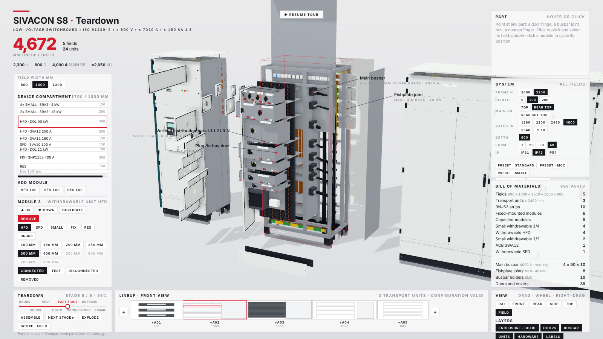

# teardown

A Claude Code skill that turns any machine into a 3D simulator you can take apart.

Ask how something works. Claude builds it as one offline HTML page: the machine runs in the middle, every panel around it reads the real numbers, a button opens the part doing the work, and when nobody touches it the page tours itself.


| Telson SC-8 robotic scorpion | Pelagos OC-8 robotic octopus |
|---|---|
|  |  |

## Install

```
npx skills add elvarofficial/teardown -g -a claude-code
```

Then, once, in the installed folder:

```
npm install && npx playwright install chromium
```

You need Node.js 20 or newer. For the video you also need `ffmpeg`, and for the sound Python 3.

## Use

Ask Claude Code in plain words:

> Build me a simulator of a 4-stroke motorcycle engine I can take apart.

> How does a mechanical watch keep time? Show me as a simulator.

> Make a teardown of a hydraulic excavator arm and record a 20-second video of it.

Or open one of the 4 examples first:

```
node sims/build.mjs v8-live          # teardown-out/dist/v8-live.html
node sims/build.mjs cessna-live
node sims/build.mjs strandbeest-live
node sims/build.mjs sivacon-live     # the configurable switchboard below
```

### SIVACON S8 switchboard: a teardown you can configure



A low-voltage switchboard built from its planning manual and operating instructions, down to the bolts. Every field is a frame of hole-row uprights on a plinth and U50 foundation, with its roof (louvred hoods for IP31, a plate on spacers for IP43, a sealed plate for IP54), rear wall, side walls, partitions, main busbar packs in comb holders, fishplate joints between transport units, PE bars, vertical distribution bars in the plug-in bus duct, cable compartment with C30 rails, terminals and cables, and the doors with hinges, locks and seals. Inside sit withdrawable units (HFD, SFD and ¼/½ miniature units with moving contact systems, position indicator, gate valve and ratchet levers), 3WA breakers in guide frames, 3NJ63 and 3NJ4 strips, capacitor stages, G120 converters and fixed modules. All 2,300+ fasteners are instances that carry their size and tightening torque.

- **Configure:** add fields at either end, duplicate, move, remove or replace them with any of 8 field types; change widths; fill the device compartments module by module on the 50 mm grid; set the frame height, plinth, busbar position, rated current, depth, form and IP for the whole lineup. The configuration is kept in the URL hash, and it exports as JSON with its bill of materials.
- **Take apart:** 8 teardown stages, for one field or the whole lineup: doors, covers, walls, units, partitions, connections, busbars, frame. Rack a unit or a breaker to TEST, DISCONNECTED or out.
- **Read:** point at any part for its data and its source, for example a fishplate bolt: M10 8.8, DIN 6796, 40 Nm.
- **3WL breaker:** a SENTRON 3WL1 built from its operating instructions and the COM35 guide. It goes into any breaker field and is configurable: frame size, rated current, breaking capacity, trip unit ETU15B–76B with its real switch positions, ground fault, poles, withdrawable or fixed, motor, releases, COM35. The front panel and the guide frame are laid out as in the manual, and the 11 maintenance steps of chapter 23 come with their fasteners and torques. The black `3WL · OPERATE` button at the top goes straight to it. In OPERATE, `solo` shows the breaker on its own (with or without its guide frame), the trip unit is fully interactive (the ETU76B graphical menu as in OI 8-42…8-64 with password, save queries, parameter sets A/B, metering, maintenance counters and waveform; switches; TEST / QUERY / CLEAR self-tests as in OI 8-74/8-75; RESET; load and fault injection), and OFF/ON, charging and racking play the manual's procedures step by step with the part to operate outlined in yellow.

Numbers and their sources are listed in `sims/sivacon-shared/SOURCES.md`.

## What is inside

| | |
|---|---|
| `SKILL.md` | What Claude reads: how a machine is built, the rules that make it look right, the review loop. |
| `sims/kit/` | Runtime, stage, shader warm-up. |
| `sims/v8-*`, `sims/cessna-*`, `sims/strandbeest-*` | 3 complete machines. `-shared` is the machine, `-live` the page you drive, `-film` the recorded tour. |
| `sims/sivacon-*` | A configurable SIVACON S8 switchboard teardown (live page only). |
| `sims/build.mjs` | Bundles a machine into one HTML file, three.js and fonts inlined. |
| `sims/capture.mjs` | Renders the film frame by frame to a 60 fps mp4, or to review sheets of stills. |
| `sfx/`, `run_sfx.py` | Procedural sound on the film's timeline, mastered to −14 LUFS. |

## Credits

Built on [whaleyxbt/claude-motion](https://github.com/whaleyxbt/claude-motion) (MIT): the runtime, frame capture, sound engine and review rules come from there. Recorded samples are CC0 from Freesound, prepared by [Barty-Bart/motion-graphics](https://github.com/Barty-Bart/motion-graphics); sources in `sfx/samples/SOURCES.md`.

MIT licence.
