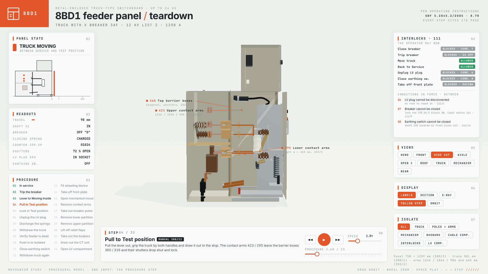

# teardown

A Claude Code skill that turns any machine into a 3D simulator you can take apart.

Ask how something works. Claude builds it as one offline HTML page: the machine runs in the middle, every panel around it reads the real numbers, a button opens the part doing the work, and when nobody touches it the page tours itself.


| Telson SC-8 robotic scorpion | Pelagos OC-8 robotic octopus |
|---|---|
|  |  |

## Install

```
npx skills add elvarofficial/teardown -g -a claude-code
```

Then, once, in the installed folder:

```
npm install && npx playwright install chromium
```

You need Node.js 20 or newer. For the video you also need `ffmpeg`, and for the sound Python 3.

## Use

Ask Claude Code in plain words:

> Build me a simulator of a 4-stroke motorcycle engine I can take apart.

> How does a mechanical watch keep time? Show me as a simulator.

> Make a teardown of a hydraulic excavator arm and record a 20-second video of it.

Or open one of the 4 examples first:

```
node sims/build.mjs v8-live          # teardown-out/dist/v8-live.html
node sims/build.mjs cessna-live
node sims/build.mjs strandbeest-live
node sims/build.mjs 8bd-live
```

### 8BD1 switchgear teardown



`8bd-live` takes apart one old-generation Siemens 8BD1 metal-enclosed truck-type feeder panel (12 kV, V breaker 3AF on a
withdrawable truck). It follows the manufacturer's operating instructions SWF 5.2845.2/2005 (issue 8.78) step by step,
in 23 steps: trip, rack to Test, unplug, discharge the springs, withdraw, verify dead, earth the feeder, then take
apart the truck (front plate, mechanism, contact arms, poles) and the cubicle (partitions, relief flaps, busbars,
CT unit, LV compartment). Every step cites its manual page. The interlock panel works out the manual's
interlock conditions (section 111) from the current pose, so it always shows what the operator may do now and which
condition blocks the rest. Printed values (panel 750 × 1259 mm, wheel track 581 mm, contact-arm heights 1246 / 1046 / 906 / 665 mm, cable lug
point 415 mm) come from the manual; the rest of the cubicle is measured off its to-scale side sections (about ±20 mm).
Values the manual does not give at all are marked `EST` in `sims/8bd-shared/kin.js`.

**FASTENERS** (key `F`) shows every screw, bolt, nut, stud, rivet and insulation cap the manual shows or names, at its
position (the partition fixing maps, the side drillings, the photos) and colour-coded by what the manual gives:
green for a stated torque, amber for a stated size only, blue for neither. Each one backs out when its step undoes it.
The manual states one torque, 70 Nm for the M12 busbar and earth-bar joints; no other value is filled in.
The full plan with the fastener table is in `sims/8bd-shared/TEARDOWN.md`.

## What is inside

| | |
|---|---|
| `SKILL.md` | What Claude reads: how a machine is built, the rules that make it look right, the review loop. |
| `sims/kit/` | Runtime, stage, shader warm-up. |
| `sims/v8-*`, `sims/cessna-*`, `sims/strandbeest-*` | 3 complete machines. `-shared` is the machine, `-live` the page you drive, `-film` the recorded tour. |
| `sims/8bd-*` | The 8BD1 switchgear teardown: a live page only (no film, tour or sound). `kin.js` holds the manual's numbers, steps and interlocks. |
| `sims/build.mjs` | Bundles a machine into one HTML file, three.js and fonts inlined. |
| `sims/capture.mjs` | Renders the film frame by frame to a 60 fps mp4, or to review sheets of stills. |
| `sfx/`, `run_sfx.py` | Procedural sound on the film's timeline, mastered to −14 LUFS. |

## Credits

Built on [whaleyxbt/claude-motion](https://github.com/whaleyxbt/claude-motion) (MIT): the runtime, frame capture, sound engine and review rules come from there. Recorded samples are CC0 from Freesound, prepared by [Barty-Bart/motion-graphics](https://github.com/Barty-Bart/motion-graphics); sources in `sfx/samples/SOURCES.md`.

MIT licence.
