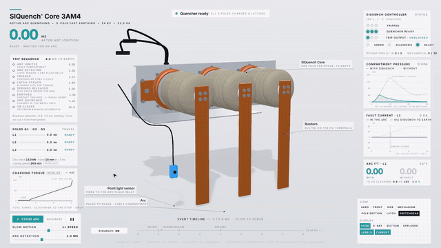

# SIQuench 3AM4 teardown

An interactive 3D teardown of the Siemens **SIQuench® Core 3AM4**, an active arc quenching device for 12-24 kV switchgear. It earths all three phases within about 4 ms of an internal arc, so the arc dies before the pressure peak. The page shows the whole trip in slow motion, then the recharge with the charging tool (Spannwerkzeug).

```
node sims/build.mjs siquench-live     # teardown-out/dist/siquench-live.html, offline, ~840 KB
node sims/build.mjs siquench-film     # the 45 s recorded tour (render(t) contract)
```



**Sources:** the *Montage- und Betriebsanleitung* 9229 0100 100 (version 0C, 06/2026) and the SIQuench brochure (2026). This explainer is independent and is not a Siemens publication. The outer shape is built to the manual's dimension drawings (Abb. 9-12). Siemens does not publish drawings of the internal mechanism, so the internals are a schematic reading of the manual's photos (Abb. 23, 39) and its text. Every number on screen is tagged as either **sourced** (read off the documents) or **modelled** (chosen so the parts move plausibly). The tables below say which is which.

**Assumed parts are marked on screen.** Any callout whose part, shape, place or stated function is not described in the documentation carries a dashed violet **ASSUMED** badge and a dashed leader, and its sub-line says what is assumed. Parts that the documentation does not show at all are drawn as a **violet ghost** (translucent, dashed edges). The full list is in [Assumed parts](#assumed-parts) below.

## How it works in one paragraph

Light sensors in the switchgear see the arc, and an arc flash relay signals the SIQuench controller. The controller fires the trip coil of each pole (X1 in the circuit diagram). The coil pulls the latch tongue up out of the way of the crosshead, and a charged disc spring stack drives the crosshead forward. The crosshead carries a copper contact rod through insulating oil onto the fixed contact behind the high-voltage terminal. The moving contact is at earth through the copper earthing plate. Once all three poles close, the three phases are bolted together on that plate, and the plate is earthed through the earthing bar on its M12 earth connection. The fault current takes that low-impedance metal path, and the arc has nothing left to burn on. The upstream circuit breaker, tripped by the same relay, clears the bolted fault tens of milliseconds later. To make the device ready again, an operator screws the charging tool into each pole's actuation opening. Turning it draws the spring stack back until the tongue drops in front of the crosshead again.

## The moving parts

| Part | What moves it | What it does | Numbers |
|---|---|---|---|
| **Trip coil** (*Magnetspule*, one per pole) | Controller output X1 1-2, after the arc flash relay picks up | Pulls a rocker that lifts the latch tongue | Exists per pole *(sourced: manual 4.1 and the circuit diagram)*. **Drawn as a ghost, ASSUMED:** none of the manual's pictures show it, so its place (under the tongue's bracket), its shape and the rocker are assumptions. Coil to tongue moving 0.65 ms *(modelled)* |
| **Rocker** | The trip coil's plunger, pulled down 5 mm | Its long arm lifts the tongue 11 mm | **ASSUMED**, ghosted. Not in the documentation |
| **Latch tongue** (*Zunge*) | The trip coil | A flat blade guided in the slot of a bracket. Latched, its lower end stands in front of the crosshead's lip. Pulled up 11 mm, it frees the spring | Blade and slotted bracket as in Abb. 39 *(sourced)*. Lift and clear time 0.2 ms *(modelled)*. Sliding surfaces greased with Isoflex Topas L32 *(sourced, manual 12.1.3)* |
| **Disc spring stack** | Stored energy, charged by the tool | Drives the crosshead and contact rod forward | Looks like the ribbed cylinder of Abb. 39 (about 14 ribs); that it is a disc stack is **ASSUMED**. 14 discs Ø80/41 × 5 mm, k = 660 kN/m, 13.0 kN charged, 1.1 kN on the closed contact, 127 J released *(modelled)* |
| **Helical springs** (*Federn*, Abb. 39 item 2) | The crosshead, as the contact closes | Two springs in front of the stack's face, as in Abb. 39: one on a rod coaxial with the stack, one on a parallel rod beside and below it. In the model both rods run forward from the crosshead through the front bulkhead to hex nuts, and the springs bear on the bulkhead | Where they sit and roughly how big they are *(sourced: Abb. 39 drawing, no dimensions)*. Greased with Isoflex Topas L32 *(sourced, 12.1.3)*. What they do, the rod ends and the rates are **ASSUMED** |
| **Crosshead** | The disc stack | Joins the charging spindle (lower axis) to the contact rod (pole axis) and carries the lip the tongue holds | Axis offset 37 mm: the actuation openings sit 114 mm above the floor, the pole axis 151.2 mm *(sourced, Abb. 9, 11)* |
| **Moving contact** (copper rod, silvered tip) | The crosshead | Crosses the oil gap onto the fixed contact and earths the phase | Travel 18 mm in 2.0 ms, 14.6 m/s at touch *(modelled)*: x(t) = A(1 − cos ωt), A = 19.7 mm, ω = 742 rad/s |
| **Sliding contact** | Fixed | Keeps the moving rod at earth through the copper plate | |
| **Fixed contact** (tulip) | Fixed, behind the HV terminal | Receives the moving contact | Terminal Ø55, 4 × M8, 12-20 mm thread engagement, 20 Nm *(sourced)* |
| **Position switches S1 / S2** | A flag on the crosshead | Report contact position and charged state, which is the controller's *Quencher Ready* | Wiring per the manual's circuit diagram (S1 21-22, S2 13-14) *(sourced)* |
| **Position switch S3** (one per pole) | Sits on the tongue's bracket, its lever beside the blade | One NC contact (21-22) per pole, the three wired in series back to the controller | Location *(sourced, Abb. 39)* and wiring *(sourced, circuit diagram)*. The manual doesn't say what S3 senses (it lists an oil-leakage position switch in the switching part). The model moves its lever with the tongue *(modelled)* |
| **Earthing plate, earth connection, earthing bar** | Fixed | The copper plate bonds the three moving contacts. At its end, the customer's earthing bar is fixed with an M12 hex screw and washer and runs to the switchgear's earth bus | Plate, earth point, M12 at 105 Nm *(sourced, Abb. 1, 23)*. The bar must carry the rated short-circuit current with at most 3 V drop *(sourced, 8.3)*. Bar material (copper), size 40 × 5 mm and route *(modelled)* |
| **Charging spindle** | The tool's thread | Draws the crosshead back, compresses the stack and reopens the contact | Pitch 2.5 mm, 2 free turns then 7.2 loaded turns *(modelled)* |
| **Spannwerkzeug** (charging tool, 3AX6210-1A) | The operator, with an SW24 spanner | Screwed clockwise into the actuation opening to the stop, then back out | Max 100 Nm at the stop. Torque is low at first, then rises steeply. While the tool is seated, the mechanical interlock is active *(sourced, manual 11.2)*. Torque curve shape *(modelled)* |

## The trip, millisecond by millisecond

At the default 1.0 ms detection. The detection slider on the page moves it between 0.6 and 1.5 ms, the brochure's range.

| t after ignition | Event | Source |
|---|---|---|
| 0 | Arc strikes phase to phase in the cable compartment | |
| 1.00 ms | Light sensor → arc flash relay → controller | brochure: 0.6-1.5 ms |
| 1.15 ms | Controller fires the three trip coils (X1) | modelled |
| 1.80 ms | Coils start pulling the tongues up | modelled |
| 2.00 ms | Tongues clear, springs released | modelled |
| 4.00 ms | Contacts touch: 3-phase metallic short to earth | brochure: earthing ~3 ms, arc out < ~4 ms from detection, ≤ 5 ms from ignition |
| ~4.6 ms | Arc current has moved into the metal path | modelled: time constant 0.12 ms |
| ~56 ms | Upstream circuit breaker clears the bolted fault | typical MV breaker, modelled |

## Assumed parts

What the documentation does and does not describe, part by part. "Assumed" means no description, drawing or photo in manual 9229 0100 100 or the brochure backs it; the model needs it to move.

| Part | What the documentation gives | What is assumed |
|---|---|---|
| Trip coil | One per pole (4.1), connection X1 1-2 per pole (circuit diagram). The controller "unlatches" the device (4.1) | Its place, shape, stroke and the way it acts on the tongue. Drawn as a ghost |
| Rocker between coil and tongue | Nothing | All of it. Drawn as a ghost |
| Latch tongue | A blade in a slotted bracket next to S3 (Abb. 39 item 1), greased sliding surfaces (12.1.3) | What it holds back (a lip on the crosshead), its 11 mm lift, which way it moves |
| Crosshead and its lip | Nothing ("Kontaktstangen" and a "Rückstellmechanismus" are named in 4.1) | All of it |
| Disc spring stack | A ribbed cylinder with about 14 ribs in Abb. 39, not named; on one pole it sits in a closed sheet-metal box | That it is a disc spring stack; 14 discs, 13 kN, 127 J, 18 mm. The box is not modelled |
| Helical springs | Two per pole on rods in front of the stack's round face, a short one on the central rod and one on a parallel rod (Abb. 39 item 2), greased (12.1.3) | Their role (here: compressed as the contact closes, against the front bulkhead), the rod ends, sizes taken from the drawing's proportions, their rates |
| Charging spindle and thread | The tool screws into the actuation opening, clockwise to the stop, max 100 Nm, torque low at first then rising (11.2) | The spindle, pitch 2.5 mm, 9.2 turns, how the thread draws the contact back |
| Mechanical interlock | Active when the tool is screwed in to the stop; closing is then impossible (11.1.1) | How it works inside |
| Moving contact rod, fixed contact (tulip), sliding contact | A contact per pole (4.1); the high-voltage part is joined to the earthing plate through the short-circuit connection (4.1) | Their shapes, places and the 18 mm travel through the oil |
| S1, S2 | Location (Abb. 39) and wiring (circuit diagram); "Quencher ready" switch (4.1) | The flag on the crosshead that works them |
| S3 | Location on the tongue's bracket (Abb. 39), NC 21-22 per pole in series (circuit diagram) | What it senses (the model moves its lever with the tongue); the manual also names an oil-leakage position switch in the switching part (4.1) |
| Earthing bar | Fixed at the earth connection with an M12 screw, 105 Nm (Abb. 23); full short-circuit current, at most 3 V drop (8.3) | Copper, 40 × 5 mm, and its route to an earth bus |
| Busbars, light sensor, arc | Main conductors bolted flat on the terminals with 4 × M8 (8.5); a light sensor feeds the arc flash relay (4.3) | Their shapes and places, the arc's path |
| Delivery state | Contacts open and the mechanism not charged (7) | Not modelled: in the model "open" always means charged and latched |

## Where the current goes

The fault current comes in on the busbars, through each pole's high-voltage terminal, into the fixed contact. It crosses the closed moving contact and goes out through the sliding contact onto the copper earthing plate. The plate bonds all three phases. In a balanced three-phase fault the three currents add up to zero there, so most of the current circulates between the phases through the plate. Only any earth-fault share leaves on the earthing bar. The bar also holds the plate, and so every moving contact, at earth potential. The current dots show both paths: denser dots meet on the plate, and sparser ones run out along the earthing bar.

## What the panels compute

- **Fault current:** 31.5 kA rms with full DC offset and X/R 17, so the first peak of L1 is 81.7 kA. The brochure's test current is 80 kA peak / 31.5 kA rms. The arc carries the current until the contacts close, then it decays into the earth path.
- **Compartment pressure:** one equation for both curves: dp/dt = k·Σ|i| − p/7 ms, with a relief flap that opens at 135 kPa and vents 70 % of the arc's heat. It is fitted to the brochure's sample. Without SIQuench it peaks at 144 kPa at 9.9 ms (brochure: about 140 kPa at about 10 ms). With SIQuench it peaks at 43 kPa at 4.2 ms (brochure: about 45 kPa).
- **Arc I²t (L1):** 0.85 kA²s with SIQuench, against 105 kA²s if the arc burns until the breaker clears. That is 0.8 %.
- **Controller LEDs:** the rows *Tripped*, *Quencher Ready* and *Trip Output* (Unblocked / Blocked), and the general *Error / Diagnosis / Ready*. They follow the manual's Abb. 30-38 step by step: all red after a trip with Diagnosis blinking, Trip Output blocked while a tool is seated, each phase green when its pole latches, and Unblocked again once the tool is out.
- **Duty:** 5 operations at the full rated short-time current and 30 mechanical operations *(sourced)*.

## Device data shown

3AM4143-1DA12-0AB2: Ur 24 kV, Up 125 kV, Ud 50 kV, Ik 31.5 kA, tk 3 s, 50/60 Hz, pole centre distance 210 mm, base plate 740 × 216 mm, pole projection 275 mm, switching part 264.5 mm deep, mass about 60 kg, IEC 62271-102, class E2. Insulating oil Shell Diala S4 ZX-I, housing of cycloaliphatic epoxy. Maintenance-free for 20 years.

## Files

| File | Job |
|---|---|
| `sims/siquench-shared/quench.js` | The numbers: dimensions, timing, the spring drive, fault current, pressure ODE, charging torque, LED logic. No three.js. |
| `sims/siquench-shared/device.js` | The geometry built from code, and `update(state)` that poses it. |
| `sims/siquench-shared/stage.js` | Studio, shadows, GTAO, the camera rig. |
| `sims/siquench-shared/console.js` | The overlay: event clock, trip sequence, poles, torque, controller LEDs, pressure, current, I²t, timeline, toggles, callouts. |
| `sims/siquench-shared/film.js` | The 45 s script: the event clock τ(t), the recharges k(t), views, callouts, the operator's cursor. |
| `sims/siquench-shared/live.js` | The page you drive: strike arc, SIQuench on/off, recharge, slow motion, detection time, scrub, views, display modes, orbit and zoom, and the auto tour. |
| `sims/siquench-shared/score.py` | The sound on the film's timeline. |

## Controls (live page)

**STRIKE ARC** (or `A`) fires a fault. **SIQUENCH ON/OFF** runs the same fault without the quencher, for comparison. **RECHARGE** (or `R`) charges the tripped poles with the tool, L3 first as in the manual. Clicking a red *Tripped* LED charges just that pole. The **slow motion** slider goes from 1/250 to 1/8,000, and **arc detection** from 0.6 to 1.5 ms. Click the **event timeline** to scrub. Views: Hero, Front, Side, Mechanism, Pole section, Latch, Switchgear (keys `1`-`7`). Display: Hood, X-ray, Section, Exploded, Labels, Current. Drag to orbit, scroll to zoom, and `H` hides the overlay. After 25 s of quiet, the auto tour takes over again.
